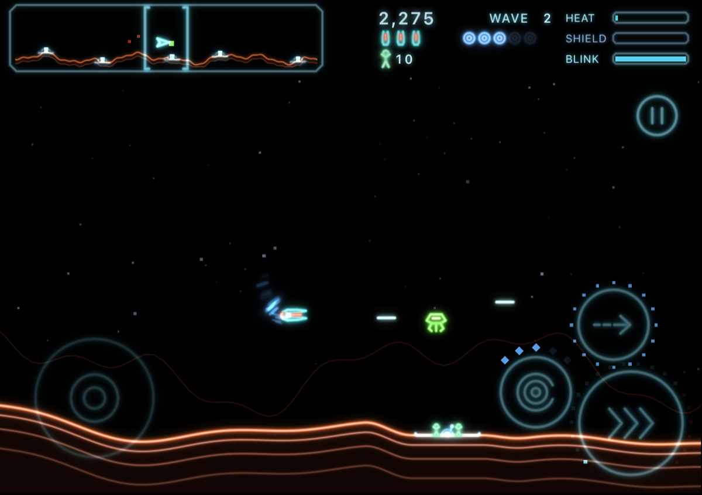

# Rimwatch

Rescue games for the iPhone Duo's inner display, set in one world: Calder, a colony built inside a
vast crater, whose wall is the Rim. Rimwatch is the game; it is made of modes, each its own game
about saving colonists. The first mode, **Ridgeline**, is a side-scrolling rescue shooter inspired
by the classic arcade game Defender (Williams Electronics, 1981). The second, **Redoubt**, is a
twin-stick arena shooter in the spirit of Robotron: 2084 (Williams Electronics, 1982). A third,
Riftwing (flap-to-fly combat), is planned.

Native iOS, written in Swift with SpriteKit. It has no third-party dependencies and no asset files:
the art is drawn in code and the sound is synthesised. The one image in the app, its icon, is drawn
by a script too.



*Ridgeline, captured on an ordinary iPhone simulator, letterboxed to the Duo's inner-display shape.*

## Inspiration

Ridgeline sets out to capture the feel of Defender: fast momentum flight over a wraparound world, a
scanner that shows all of it, and a loop built on protecting people on the ground and catching them
when they are carried off.

It is a tribute, not a copy. The name, ship, enemies, art, sounds and screen layout are its own,
and it adds mechanics of its own too: the heat meter, Blink, the carry multiplier, the shield and
Blackout. Redoubt takes the twin-stick arena genre the same way: its orb, enemies, colonist line,
airlock and power cut are its own. Rimwatch is not affiliated with or endorsed by the owners of
Defender or Robotron.

## Status

Ridgeline is finished and was checked in the simulator. Redoubt is playable from the title screen,
with its own sounds, music and haptics, but still being built: its effects and tuning are first
versions, and its sound has been measured, not yet listened to on a phone. The game has not yet been run on a real
iPhone Duo, so the open inner display (layout around the crease and camera hole), play feel,
speaker sound, haptics and physical controllers are untested. `PLAN.md` lists what is left and the
plan for the other modes.

## The title screen

The title shows the Rimwatch emblem, the name and the setting, Outpost Calder. Below them is one
item per mode, then Options and High scores. Highlighting a mode shows a line about it and its best
score; choosing it starts a run. Each mode keeps its own top-10 table, and the high-score screen
names the mode whose table it shows (with more than one mode, left and right switch between
them). The game opens on the mode played last, with that mode's scenery behind the title. Ending a
game, or continuing after game over, comes back here.

## Ridgeline

You patrol a wraparound planet strip about eight screens wide. A scanner across the top shows the
whole world.

- **The loop:** colonists live in domed outposts. Harvesters descend, grab one and lift it away.
  Shoot the Harvester, catch the falling colonist and carry them back to an outpost. An abduction
  that completes turns the pair into a Husk, a fast hunter.
- **Enemies:** Harvester (abductor), Husk (hunter), Sower (lays tethered mines), Brood (splits into
  Motes when shot), Lancer (telegraphed charge across the screen) and Anchor (lands and drills an
  outpost until destroyed). Each kind first appears in a wave of its own.
- **Your ship:** a pulse lance that overheats if you hold fire too long, a Shockwave with limited
  charges that clears the screen, and Blink, a short dash on a cooldown.
- **Twists:** carrying several colonists at once builds a score multiplier. Returning them charges
  your shield. Losing every colonist triggers Blackout: the terrain goes dark, the scanner switches
  off and Husks swarm until a supply drop restores an outpost.
- **Structure:** escalating waves, three lives, an extra life every 40,000 points and a local
  top-10 high-score table.

## Ridgeline controls

| Action | Touch | Gamepad |
|---|---|---|
| Fly | Floating stick under the left thumb | Left stick or D-pad |
| Fire (hold to autofire) | Fire button, right thumb | A |
| Blink | Blink button | B |
| Shockwave | Shockwave button | X |
| Pause | Pause button | Menu |

Options let you swap the touch controls to the other hand and swap Blink and Shockwave on the
gamepad. The touch controls hide while a controller is connected, and menus work with either.

Sound respects the phone's Silent mode: with Silent mode on, the game plays no sound or music.

## Redoubt

You fly a hover orb over the floor of a breached outpost dome, seen from above on one fixed
screen. A thin strip along the top holds the score, the wave, lives, Shockwave charges and the
colonists still to save.

- **The pace:** the floor is crowded from the first second of a wave, and more pour in while you
  fight. Pushing the aim stick fires a constant stream of shots, about ten a second, with no fire
  button, heat or reload.
- **The loop:** colonists shelter around the floor. Touch one and they follow you in a line; lead
  the line to the airlock to deliver them all at once. Each colonist in the line is worth more than
  the one before, so long lines pay, but enemies can take followers off the end. Every fourth
  colonist delivered earns a Shockwave charge.
- **Enemies:** Skitter (the flood), Gleaner (drags colonists away and becomes a Husk if it gets
  one out), Spitter (keeps its distance and fires slow shots), Burrow (a hole in the floor that
  pours out Skitters until shot shut), Thresher (a heavy that shots only push back; only a
  Shockwave destroys it) and Husk (the fast hunter). Every arrival is marked on the floor a second
  before it lands.
- **Power cut:** lose every colonist of a wave and the next is fought in the dark, with a pool of
  light round the orb, until you deliver a colonist.
- **Structure:** a wave ends when the floor is clear; colonists still safe score a bonus. Three
  lives, an extra life every 60,000 points, and its own top-10 table.
- **Sound:** its own patches and music on the same synthesiser as Ridgeline. The stream of fire is
  a soft, short pip in three pitches; a crowd dying is a light rattle, one sound per frame however
  many die, with the bigger kills each heavier in proportion to their worth. By ear you can follow
  a colonist being seized (a shrill alarm), freed, lost or crushed, a Husk forming, a Spitter
  winding up, shots clanking off a Thresher, a Burrow cracking as it is shot, groups arriving, the
  line growing, and a delivery whose fanfare grows with the line. The Shockwave is the loudest
  sound in the game. The music is tense and driving while a wave is fought, drops its pulse in
  the short break between waves and sinks to a drone in a power cut. Haptics are kept for what
  matters: no buzz per shot or per Skitter.

## Redoubt controls

| Action | Touch | Gamepad |
|---|---|---|
| Move | Floating stick under the left thumb | Left stick or D-pad |
| Aim and fire | Floating stick under the right thumb; fires while pushed | Right stick; fires while pushed |
| Shockwave | Button above the aim stick | Either shoulder button |
| Pause | Pause button | Menu |

Each stick appears wherever a thumb lands in its half of the screen. The Stick side option swaps
the two sticks (the Shockwave button goes with the aim stick). Redoubt has no gamepad layout
option.

## Fold behaviour

Gameplay only runs on the open inner display.

| Phone | What happens |
|---|---|
| Open | The game plays in landscape on the inner display. |
| Closed | The game pauses at once and the outer display shows the pause menu in portrait: start over, end game, options and high scores. Resume waits until the phone is opened. The title screen, options and high scores work closed too; choosing a mode waits until the phone is opened. |
| Reopened | The pause menu appears on the inner display, and Resume leads into a short countdown. |
| No hinge (any other iPhone) | A "Made for iPhone Duo" screen. |

## Requirements

- macOS 26.6 or later with Xcode 27.1 or later.
- iOS 27.1 or later on the device or simulator.
- The iPhone Duo simulator needs its own runtime build; see "Progress" in `PLAN.md`.

## Building and running

1. Open `Rimwatch.xcodeproj` in Xcode.
2. To run on a device, choose your team under the Rimwatch target's Signing & Capabilities.
3. Pick a run destination and press Run.

To play on an iPhone that does not fold, add the launch argument `-hinge open` to the scheme's Run
action. The game then plays letterboxed to the Duo's shape. This works in Debug builds only.

## Tests

The game logic is a plain Swift package and its tests run with Xcode closed:

```sh
cd GameCore
swift test
```

The tests use Swift Testing. If `import Testing` fails, the Command Line Tools are selected instead
of Xcode. Run `DEVELOPER_DIR=/Applications/Xcode.app/Contents/Developer swift test`, or switch
`xcode-select` to Xcode.

Difficulty was tuned against scripted bots, not people. After changing a mode's `Tuning.swift` or
`WaveDirector.swift`, re-run the bot harness as well as the tests:

```sh
cd Tools/Harness
swift build -c release -Xswiftc -DDEBUG
.build/release/Harness 80 20 idle novice competent shooter          # Ridgeline
.build/release/Harness redoubt 80 20 idle novice competent          # Redoubt
```

The arguments are the number of seeds, a cap in minutes per game, and the bots to run. A leading
`redoubt` runs Redoubt's bots instead of Ridgeline's.

## App icon

The icon is the game's emblem, "The Rim": the crater's rim seen from above as a rough orange ring,
a thinner inner ring, and the patrol ship's arrowhead crossing the centre, in neon lines on black.
The title screen draws the same emblem. Its geometry lives in one place,
`GameCore/Sources/GameCore/Emblem.swift`, which Ridgeline's ship hull also comes from.

The icon is generated, not drawn by hand. After changing the emblem, regenerate it from the
repository root:

```sh
swift run --package-path Tools/Icon Icon Rimwatch/Assets.xcassets/AppIcon.appiconset/AppIcon.png
```

## Project layout

| Path | What it holds |
|---|---|
| `GameCore/` | The game logic as a Swift package, with no UIKit or SpriteKit, and its tests. Its `RidgelineCore` target is the Ridgeline mode: world, simulation, enemies, waves, scoring and the theme, plugged into the shared session in `RidgelineMode.swift`. Its `RedoubtCore` target is Redoubt's: the run (`RedoubtRun`), enemies, colonist line, waves, bots, its theme (`Theme.swift`, `Themes/CalderDome.swift`, with sounds and music in `Themes/CalderDomeSounds.swift`), and in `Audio/` the rules for which events are voiced (`RedoubtSoundDirector`) and the music mood (`RedoubtMoodDirector`). Its `GameCore` target is what any game mode can share: maths, shapes, the emblem, sound rendering and music, menus, options, saved settings (one high-score table per mode and the mode played last), gamepad logic, the list of modes the title offers (`ModeCatalog`), and in `Session/` the title, pause, countdown and screen flow around a run (`ModeSession`, `ModeFrontEnd`), written against the `ModeRun` protocol each mode's simulation conforms to. The game logic knows what each entity does, never how it looks; appearance and sound come from a `Theme`. |
| `Rimwatch/` | The app. |
| `Rimwatch/Shell/` | The parts of the app any mode shares, with no Ridgeline in them. `ShellScene` is the one SpriteKit scene: it owns the devices every mode shares (`ShellDevices`: the synth, the game controller, haptics) and loads one mode at a time, swapping modes when the title asks. `ModeHost` runs the loaded mode inside it (screen flow, menus, pause, countdown, sound, settings, touches) through the `GameMode` protocol in `GameMode.swift`. Also fold handling, the glow renderer, the emblem, and the menu screens and play overlays, whose look comes from a `ShellStyle`. |
| `Rimwatch/Modes/` | `ModeRegistry.swift` lists the modes and is the only shell-level file that names one. |
| `Rimwatch/Modes/Ridgeline/` | Ridgeline as a `GameMode`: `RidgelineMode.swift` (layout, screens, input, sound) with its backdrop, events and per-entity sync in `RidgelineMode+Backdrop.swift`, `+Events.swift` and `+Sync.swift`, plus the terrain, scanner, HUD, particle effects, callouts, touch controls and entity glyphs. |
| `Rimwatch/Modes/Redoubt/` | Redoubt as a `GameMode`: `RedoubtMode.swift` (layout, screens, input, sound, music and haptics) with the floor, airlock, darkness and sprite pools in `+Arena.swift`, the per-frame sync in `+Sync.swift` and events in `+Events.swift`, plus its HUD, twin-stick touch controls, effects, callouts and glyphs. |
| `Tools/Harness/` | The bot harness used for difficulty tuning. |
| `Tools/Icon/` | The script that draws the app icon from the emblem in `GameCore`. |
| `PLAN.md` | The design, the build history and what is left. |
| `CLAUDE.md` | Working notes for building the project with Claude Code. |

Each mode's gameplay numbers live in its own `Tuning.swift`: `GameCore/Sources/RidgelineCore/` and
`GameCore/Sources/RedoubtCore/`.

## Debug launch arguments

These exist in Debug builds only.

| Argument | Effect |
|---|---|
| `-hinge open\|closed\|none` | Overrides the fold state. |
| `-autopilot [idle\|novice\|competent\|shooter]` | A bot plays the game. Plain `-autopilot` is `competent`; `shooter` never rescues; `idle` never touches the controls and `novice` plays badly, so both reach game over quickly. Redoubt has the same four; its `shooter` never rescues and leaves Gleaners alone, so it reaches the power cut (with `-seed 7`, in wave 8). |
| `-showStats` | Shows node count, draw count and frame rate. |
| `-resetSettings` | Clears saved options, the remembered mode and every mode's high scores at launch. |
| `-logFeedback` | Logs every routed sound and haptic. |
| `-realPads` | Uses real controllers in the simulator, which otherwise reports a phantom one. |
| `-dumpAudio <dir>` | Writes every sound and music mood of the mode loaded at launch to WAV files (pick it with `-mode`). |
| `-seed <n>` | Starts the session from seed `n` instead of the clock, so the runs are the same every launch. |
| `-fixedFrame` | Counts every frame after the first as exactly 1/60 s, whatever the real time. With `-seed` and `-autopilot`, runs play out the same way every time; the `[Rimwatch run]` lines log each run's seed and result. |
| `-mode <id>` | Loads mode `<id>` at launch (`ridgeline` or `redoubt`) instead of the one played last. |
| `-debugSecondMode` | Lists Ridgeline a second time as "Ridgeline B" (id `ridgelineB`, with its own high-score table), so switching between two copies of one mode can be tried. |

`PLAN.md` also lists the Darwin notifications that change the fold state and drive the menus and a
simulated controller at run time.
